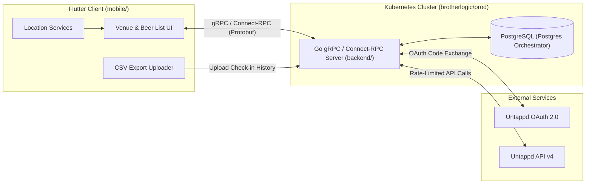

# BSR (Beer Selector & Recommender) — Project Intent & Architecture

## 1. Overview & Vision

**BSR** is a mobile application for choosing what beer to drink at a bar, pub, or brewery. When a user walks into a venue and opens the app, BSR identifies the venue via GPS or search, determines the available beer selection from Untappd venue activity, cross-references it against the user's personal Untappd history, and presents a ranked list tailored to either discovering top-rated new beers or enjoying a personalized blend of global and personal favorites.

---

## 2. Core Product Flows & Ranking Modes

### 2.1 Venue Discovery
- **GPS / Nearby Lookup**: On launch, the app requests device location (lat/lng) and queries the backend for nearby Untappd venues (`/v4/venue/search`).
- **Text Search**: Users can also manually search for a venue by name.

### 2.2 Ranking & Filtering Modes
Once a venue is selected, available beers are displayed in one of two primary views:

1. **Discover New**
   - **Filter**: Strictly excludes any beer the user has previously checked in on Untappd.
   - **Ranking**: Sorted descending by Untappd Global Community Rating (`0.0–5.0`).
   - **Purpose**: Answer *"What is the best beer here that I haven't tried yet?"*

2. **Rated Blend (Top Rated)**
   - **Filter**: Includes all beers available at the venue (both tried and untried).
   - **Scoring Formula** (normalized to a `0.0–5.0` scale):
     - **Tried / Rated Beers**:
       $$\text{Score} = (0.6 \times \text{User Rating}) + (0.4 \times \text{Global Rating})$$
     - **Untried Beers**:
       $$\text{Score} = 1.0 \times \text{Global Rating}$$
   - **Purpose**: Loved beers bubble to the top, disliked beers sink, and high-scoring untried beers remain competitive—ensuring the view is always useful even at a brand-new brewery.

---

## 3. High-Level System Architecture

### 3.1 Repository Structure (Monorepo)
- `proto/`: Protocol Buffer (`.proto`) definitions for all RPC services and messages.
- `backend/`: Go server implementing the gRPC / Connect-RPC API, Untappd API client, rate-limit budgeter, CSV ingestion parser, and PostgreSQL persistence layer.
- `mobile/`: Flutter cross-platform mobile client (iOS & Android).
- `deploy/`: Dockerfile and Kubernetes manifests targeting the `brotherlogic/prod` cluster.

---

## 4. Authentication & User Identity

- **Single Sign-On via Untappd OAuth 2.0**: No separate BSR username/password system.
- **Flow**:
  1. The Flutter client opens the Untappd OAuth authorization screen:
     `https://untappd.com/oauth/authenticate/?client_id=CLIENT_ID&response_type=code&redirect_url=REDIRECT_URL&state=STATE`
  2. Untappd redirects back to the Go backend callback endpoint with an authorization `code`.
  3. The Go backend exchanges the `code` for an Untappd `access_token` via `https://untappd.com/oauth/authorize/`.
  4. The backend fetches the user's Untappd profile (`/v4/user/info`), stores the user record and non-expiring `access_token` in PostgreSQL, and issues a session token to the Flutter client.

---

## 5. Data Sourcing, Rate Limiting & Caching Strategy

Untappd's Public API v4 enforces a strict rate limit of **100 requests per hour per user token** (tracked via `X-Ratelimit-Limit` and `X-Ratelimit-Remaining` response headers) and does not expose paid *Untappd for Business* digital menus. BSR works within these constraints using the following strategies:

### 5.1 User Check-in History Ingestion
1. **CSV Upload (Primary / Bulk Option)**:
   - Untappd Supporters (or users with GDPR data exports) can upload their check-in CSV file directly through the Flutter app.
   - The Go backend parses the CSV (`bid`, `beer_name`, `brewery_name`, `beer_style`, `beer_abv`, `rating_score`, `global_rating_score`, `created_at`) and bulk-upserts the history into PostgreSQL with zero API calls used.
2. **Untappd API Sync (Fallback & Incremental Updates)**:
   - For users without a CSV export (or to fetch check-ins logged after a CSV upload), the backend syncs via `/v4/user/beers` (which returns up to 50 distinct rated beers per page) and `/v4/user/checkins`.
   - Background pagination continues as far back as the user's remaining hourly API quota permits while reserving a safety buffer (e.g., 15–20 requests/hour) for live interactive venue searches.

### 5.2 Venue Beer List Discovery & Long-Term Caching
- **Inferring Available Beers from Check-ins**:
  - When a user selects a venue, the backend queries `/v4/venue/checkins/{VENUE_ID}` to extract distinct beers recently checked in at that location, pulling as many pages of check-ins as the current rate-limit budget allows.
- **Long-Term PostgreSQL Cache (~30-Day TTL)**:
  - Venue check-ins, deduplicated venue beer rosters, and global beer metadata (`bid`, name, brewery, style, ABV, label URL, global score) are cached in PostgreSQL with a **30-day TTL**.
  - Subsequent visits to a cached venue return instantaneously from PostgreSQL without consuming Untappd API calls unless the cache has expired or the user explicitly triggers a top-up sync.

---

## 6. Database Schema (PostgreSQL Overview)

- **`users`**:
  - `untappd_uid` (PK), `username`, `access_token`, `last_sync_at`, `created_at`
- **`beers`**:
  - `bid` (PK, Untappd Beer ID), `name`, `brewery_name`, `style`, `abv`, `ibu`, `label_url`, `global_rating`, `updated_at`
- **`user_beers`**:
  - `untappd_uid` (FK), `bid` (FK), `user_rating`, `checkin_count`, `first_had_at`, `last_had_at`
  - Primary Key: `(untappd_uid, bid)`
- **`venues`**:
  - `venue_id` (PK, Untappd Venue ID), `name`, `address`, `lat`, `lng`, `last_fetched_at`
- **`venue_beers`**:
  - `venue_id` (FK), `bid` (FK), `last_seen_checkin_id`, `last_seen_at`, `checkin_count_at_venue`
  - Primary Key: `(venue_id, bid)`

---

## 7. gRPC / Connect-RPC API Surface (`proto/bsr/v1/bsr.proto`)

- `AuthService`:
  - `GetAuthURL(GetAuthURLRequest) returns (GetAuthURLResponse)`
  - `ExchangeAuthCode(ExchangeAuthCodeRequest) returns (ExchangeAuthCodeResponse)`
- `UserService`:
  - `UploadHistoryCSV(UploadHistoryCSVRequest) returns (UploadHistoryCSVResponse)`
  - `SyncUserHistory(SyncUserHistoryRequest) returns (SyncUserHistoryResponse)`
  - `GetSyncStatus(GetSyncStatusRequest) returns (GetSyncStatusResponse)`
- `VenueService`:
  - `SearchVenues(SearchVenuesRequest) returns (SearchVenuesResponse)` *(by lat/lng or text query)*
  - `GetVenueBeers(GetVenueBeersRequest) returns (GetVenueBeersResponse)` *(returns beers with both `discover_new` eligibility and precomputed `blended_score` / `global_score`)*
  - `RefreshVenueBeers(RefreshVenueBeersRequest) returns (RefreshVenueBeersResponse)` *(optional manual top-up within rate limits)*

---

## 8. Implementation Roadmap

Each phase is specified in its own document with detailed deliverables, realistic integration test requirements, and strict exit criteria:

1. **[Phase 1: Protobuf & Backend Foundation](PHASE1.md)**
   - Define `proto/bsr/v1/bsr.proto` and generate Go & Dart stubs.
   - Set up Go service scaffold, PostgreSQL migrations, and Kubernetes deployment configs (`deploy/`).
2. **[Phase 2: Untappd OAuth & User History Pipeline](PHASE2.md)**
   - Implement Untappd OAuth 2.0 endpoints and rate-limit-aware Untappd v4 client in Go.
   - Implement CSV history parser and `/v4/user/beers` background syncer.
3. **[Phase 3: Venue Discovery & Ranking Engine](PHASE3.md)**
   - Implement `/v4/venue/search` and `/v4/venue/checkins` fetcher with 30-day PostgreSQL caching.
   - Implement the **Discover New** and **Rated Blend (60/40)** ranking logic.
4. **[Phase 4: Flutter Mobile App](PHASE4.md)**
   - Build OAuth login flow, GPS venue finder, CSV file picker, and the two-tab venue beer list UI (**Discover New** vs **Rated Blend**).
